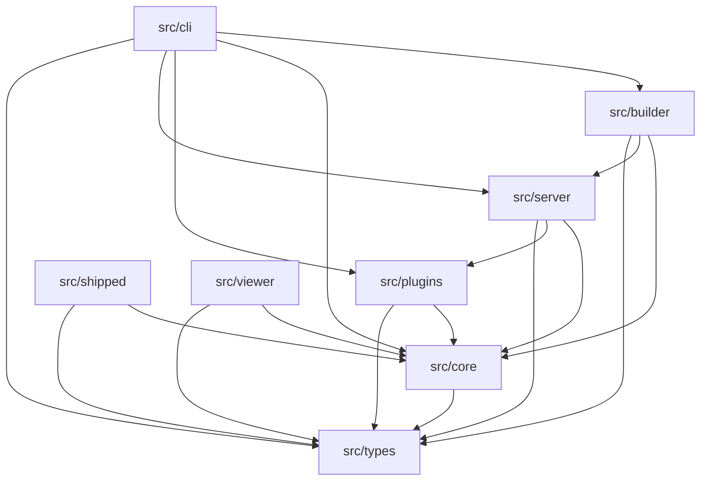
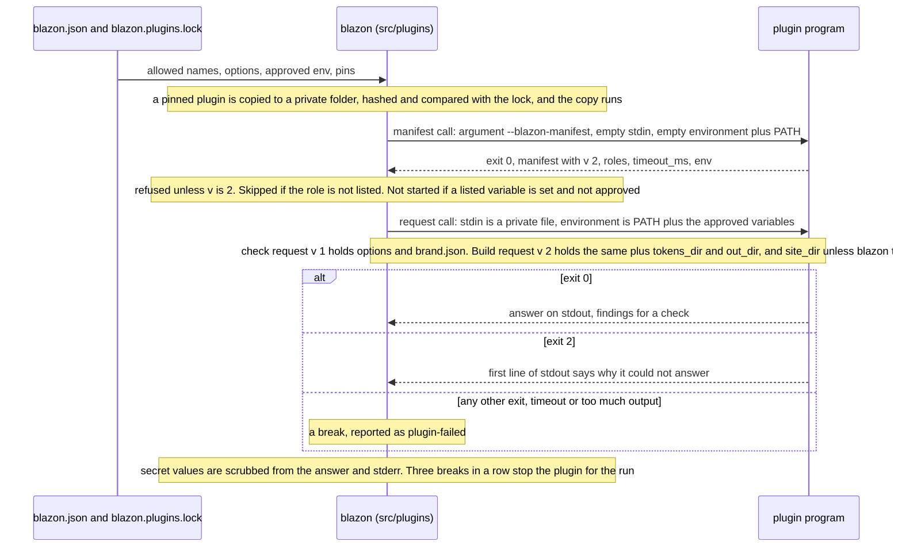

# Architecture

A map of the code for someone about to change it. [README](README.md) says what blazon does, [CONTRIBUTING](CONTRIBUTING.md) has the hooks and test layout, [docs/rfc](docs/rfc) is normative. [CLAUDE.md](CLAUDE.md) holds the traps that cost time before.

## The shape

One compile reads a brand's folder and produces one value, `BlazonData` (`compileBlazonData`, `src/core/index.ts`): the token tree with aliases resolved, the pages, the assets and the findings. Everything else is a consumer of that value.

```text
tokens/ docs/ assets/ blazon.json
        │
        ▼
  compileBlazonData ──► BlazonData ──┬─► blazon check   (prints the findings)
        (core)                     ├─► blazon tokens  (theme.css, tokens.ts, tokens.json)
                                   ├─► blazon build   (static site, brand.json, then build plugins)
                                   └─► blazon dev     (the same compile, kept live)
```

`blazon check`, `tokens` and `build` run the check first and stop on an error finding. A plugin with the `check` role adds findings to the same list; a plugin with the `build` role runs after the site is written.

## Layers of `src/`

| Folder | Holds |
|---|---|
| `types` | The shapes shared by everything |
| `core` | The compile, the checks, the emitters, the config, the asset scanner |
| `plugins` | The plugin host: admission, calls, roles, pins |
| `shipped` | The source of the plugins blazon ships; each is a standalone program |
| `viewer` | The brand book's React app |
| `server` | The dev server, and the plugin runs it drives |
| `builder` | The static site build |
| `cli` | The commands |

An arrow means "may import". An import with no arrow is refused by a test. The files directly in `src/` (the package's public entry) may import anything.

<!-- layers:begin -->

<!-- layers:end -->

The diagram is written from `scripts/layers.json` by `npm run layers-docs`. That file is the one table of rules: `test/core/layers.test.ts` enforces it, and `test/docs/layers-generated.test.ts` fails when the diagram above differs from it. A helper two layers need goes down into `core`.

## A plugin call

A plugin is a program that blazon starts once for each call. Only the operator's `blazon.json` names one. A call is either the manifest call or a request; the contract is [RFC 0005](docs/rfc/0005-plugin-protocol.md), and [Writing a plugin](docs/manual/13-writing-a-plugin.md) is the author's view.



## Code map

- `src/core/tokens/`: load the files, merge them into one tree (`walk.ts`, `merge.ts`), resolve aliases (`alias.ts`, `resolve.ts`) and the resolver document's contexts (`contexts.ts`, `resolver/`).
- `src/core/checker/`: one file per kind of rule. `catalogue.ts` is the list of finding codes with their severity, scope and docs; a code that is not there does not compile. The order findings are reported in is fixed in `src/core/order.ts`.
- `src/core/docs/`: the Markdown pages and their directives. `src/core/assets/`: the asset scanner and the sidecars.
- `src/core/emit.ts`, `outputs.ts`, `preflight.ts`: writing token files, and the refusals that come before anything is written.
- `src/core/brand/`: `brand.json`, its schema and its version.
- `src/core/inputs.ts`: the one list of the paths a compile reads.
- `src/core/operations/`: the operations list (`list.ts`), the one definition of each read command and MCP tool: its name, title, description, input and output schema, annotations, how the command line takes it and how the server runs it. Plain data, with the pure functions that check arguments (`check.ts`) and build a tool from an operation (`project.ts`). `src/core/read/` holds the lookups the operations answer from.
- `src/cli/operations.ts` and `src/cli/handlers/`: the commands that are operations. `operations.ts` registers each one with the parser from the list (its words, arguments, options and help line), and `handlers/` holds one handler for each, which reads the brand and returns the answer as data and as text. `check`, `build` and the other commands are registered by hand in `src/cli/index.ts`.
- `mcp/`: the MCP server, a separate package that runs the blazon command line. It cannot import `src/`, so `mcp/src/generated/` is a copy of the operations that have a tool and of the pure code above, written by `npm run gen:mcp` and compared with the source by a test.
- `src/plugins/host/`: how a plugin program is admitted and called. `wire/` is the protocol (manifest, limits, environment), `roles/` is what each role may do, `pins/` is how a plugin is pinned.
- `src/shipped/<name>/`: one folder per shipped plugin, each with its own `main.ts`; `shared/` holds what they have in common. `plugins/` at the repo root holds each one's folder: `scripts/build-plugins.mjs` bundles `main.ts` and everything it imports into the one file `bin/blazon-<name>.🔌`, and writes `shipped.lock` over the folders. Both are build output.
- `src/viewer/`: the brand book's React app. `vite.viewer.config.ts` builds it into `dist/ui`, which an installed blazon serves.
- `examples/blazon/` is blazon's own brand book and the starter `blazon init` copies; `examples/conformance/` is the conformance fixture; `examples/plugins/` holds reference plugins.

## Invariants

- **One compile, many readers.** The CLI, the dev server, the static build and the plugins all take the same `BlazonData`. A rule that only one of them enforces is a bug.
- **Refusals come before writes.** `buildSite` and `emitTokenOutputs` refuse a brand with error findings, a pin that is not met and an output folder that is, holds or sits inside an input, and they do so before they delete or write anything.
- **A read operation is defined once.** What the command line shows and what an MCP client receives come from `src/core/operations/list.ts`. A new read command or tool starts there; `test/core/operations.test.ts` fails when an operation has a command and no handler, or only one of the two surfaces without being named as such.
- **Inputs are listed once.** `projectInputs` is what the dev server watches and what the output check protects. A path a compile starts to read goes there.
- **Findings have a total order.** The same brand gives the same findings in the same order on every machine (`compareFindings`).
- **A check holds in every resolver context.** A context stores only its changes; `contextItems` puts one back together and `contextFindings` runs the checks on each.
- **`brand.json` is versioned.** It carries `format: "blazon-brand"` and a `version`. A reader of it, blazon's own included, refuses any other.
- **A plugin is a program, not a library.** It gets one JSON request and answers with findings or files, inside the limits of the wire profile. A shipped plugin imports from `core` and `shared`, never from `plugins` or `server`.
- **The docs are tested against the code.** The manual and RFC 0001 must name every command, flag, config key, directive and finding code (`test/docs/`).

## Where to start for a change

| You want to | Start at |
|---|---|
| Add a check | `src/core/checker/catalogue.ts`, then the rule's file; CLAUDE.md lists the steps that follow |
| Add a token type or a field | `src/types/tokens.ts`, `src/core/tokens/values/`, then the emitters in `src/core/tokens/formatters/` |
| Add a page directive | `src/core/docs/directives.ts` and its viewer component in `src/viewer/` |
| Add a read command or an MCP tool | `src/core/operations/list.ts`, then a handler in `src/cli/handlers/` (and `npm run gen:mcp`); CONTRIBUTING, "Read commands and MCP tools", has the steps |
| Add a shipped plugin | `src/shipped/<short>/main.ts`, a folder `plugins/<name>/`, then `npm run build:plugins` |
| Change what a build writes | `src/core/emit.ts` and `src/builder/site-builder.ts`, keeping the preflight first |
