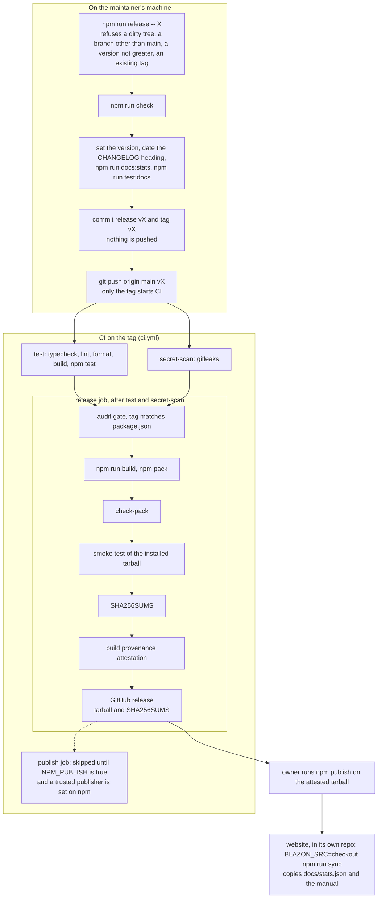

# Contributing

## Local setup

Blazon needs Node 24 or later (`engines` in `package.json`), the current LTS, which CI uses. On a slow or loaded machine the suite's time limits are generous on purpose (`hookTimeout` in `vitest.config.ts`, per-test limits on the slow ones); a timeout that still fires there is worth a look, not a bump. [uv](https://docs.astral.sh/uv/) is needed for the Python script tests.

```bash
git clone https://github.com/iksnerd/blazon.git
cd blazon
npm install
npm run hooks
npm test
```

`npm run typecheck` runs the TypeScript 7 compiler (`typescript7`) with `--noEmit`, on the root project and on `mcp/` (`scripts/typecheck-mcp.mjs`). Lint and the declaration step of the build still use TypeScript 6 (`typescript`), because typescript-eslint and vite-plugin-dts need the JS API that 7 does not ship yet; and `npm run build` builds `dist/`. Run it before `blazon check` on a brand or any build that uses the shipped `blazon.print-book` plugin: the plugin's program, `plugins/blazon.print-book/bin/blazon-blazon.print-book.🔌`, is build output (`npm run build:plugins`, which `npm run build` runs), so without a build it is missing and the call fails with `plugin-failed`. The suite builds the programs and `plugins/shipped.lock` itself when they are older than their sources. The README's Contributing section lists `npm run dev:blazon`.

## Linting and formatting

Three tools look after the code; each has one job.

| Tool | Looks at | Run it with |
|---|---|---|
| ESLint (`eslint.config.js`) | TypeScript and JavaScript: mistakes, not layout. `src/` also gets the rules that need types (`no-floating-promises`, `no-misused-promises`, `await-thenable`), which add about five seconds | `npm run lint`, and `npm run lint:fix` for the fixes it can make safely |
| Ruff (`ruff.toml`) | the Python in `scripts/` and `test/deck/python/`, run through `uv` | `npm run lint:py` |
| Prettier (`prettier.config.js`) | the layout of `src/`, `test/` and `scripts/` (not Markdown, JSON, SVG, `examples/` or `plugins/`, which are written by hand to be read: see `.prettierignore`) | `npm run format` rewrites, `npm run format:check` lists what differs; the pre-commit hook and CI check it |

`npm run check` runs the typecheck, ESLint, Ruff and the Prettier check. The reformat that brought the code to Prettier's layout is listed in `.git-blame-ignore-revs`, which GitHub reads by itself; locally run `git config blame.ignoreRevsFile .git-blame-ignore-revs` so `git blame` skips it too. `.editorconfig` holds the indent, line ending and final newline for editors that read it.

To allow what ESLint refuses, write `// eslint-disable-next-line <rule> -- <why>` on the line before it: the reason is part of the comment, and an unused disable is itself reported. A rule is turned off for a folder in `eslint.config.js`, with the reason beside it.

## Tests

Test files sit in `test/` in a folder for their subject:

| Folder | Tests |
|---|---|
| `core/` | Tokens, the checker, assets and icon sets, config, pages and the starter-file-unchanged note |
| `brand/` | `brand.json`, its schema and the Python readers |
| `build/` | The CLI, `blazon build`, the token outputs and the dev server |
| `viewer/` | The brand book's React components |
| `deck/` | The PDF deck (its plan, its fonts, the real brands) |
| `drift/`, `init/` | `blazon drift` and `blazon init --from` |
| `plugins/` | The plugin host, the roles, the shipped plugins and the example plugins |
| `examples/` | The golden files for the examples, and a brand derived with `blazon init` (reference material, see below) |
| `corpus/` | The check corpus: a case for each finding code, and a near-miss |
| `server/` | Parts of the dev server: coalescing events, the error reporter |
| `surface/` | The public surface of the package, compared with `public-surface.json` |
| `docs/` | The manual and RFC tests: every command, flag, config key and finding code is documented, and the finding tables match the catalogue |
| `hooks/` | The pre-commit and pre-push hooks |
| `scripts/` | The scripts in `scripts/` |
| `spec/` | A vendored copy of the plugin protocol's conformance corpus, which the host is tested against |
| `support/` | Shared helpers, not tests |

Use the helpers in `test/support/` instead of writing your own: `tempDir()` makes an empty temporary folder, `tempProject({ 'tokens/colors.json': {...} })` makes one with files, `starterProject()` makes one that `blazon init` wrote, `exampleProject('blazon')` makes a copy of an example so a build does not write `dist/` into the repository, and `REPO` is the repository root. Folders made this way are removed when the test file ends.

Start child processes with `spawnSync` and `execFileSync` from `test/support/spawn`, not from `node:child_process`. A synchronous call blocks the worker, so vitest's test timeout cannot stop it, and one child that never exits would stall the suite and the commit hook for good. The helpers kill a child after five minutes (`DEFAULT_SPAWN_TIMEOUT_MS`) and report `ETIMEDOUT`; pass your own `timeout` for a shorter limit. They also hand `input` to the child as a temporary file, not through Node's stdin socket: a socket's end-of-file was sometimes lost in the test workers, and a Python script reading `sys.stdin` then waited forever.

### The corpus report

The host's own tests read every file of the vendored corpus in `test/spec/`. `npm run conformance:reads` runs them with `CONFORMANCE_READS` set, so that each corpus file a test loads and whether that test passed is recorded, and writes `reads.json` in the `reads-v1` shape (a path relative to the corpus and a pass or fail for each file; a file no test read is left out and counts as not run). A conformance report for the host is made from that file. Nothing is recorded when the variable is not set.

## The website's numbers

`docs/stats.json` holds what the project website shows: the version, the commands, the count of finding codes by severity, the MCP tools and the manual chapters. `npm run docs:stats` writes it from the code (`scripts/docs-stats.ts`), and `test/docs/stats.test.ts` fails when the committed file differs from what the code gives. Run the script and commit the file when you add a command, a finding code, an operation or a manual chapter, or change the version.

## Read commands and MCP tools

`get`, `list`, `rules`, `can`, `fonts`, `logo` and `brand` on the command line, and the tools of the MCP server (`blazon-mcp`, source in `mcp/`), are the same operations, defined once in `src/core/operations/list.ts`. An entry has the name (the tool name), the title, the description, the input and output schema, the annotations, `cli` (the words, the positional arguments, the options and the help line, or `false`) and `mcp` (how the server runs the command, or `false` for no tool).

To add one:

1. Write the lookup in `src/core/read/`, and the entry in `list.ts`. A property that only the command line takes (the brand folder, `dir`) is named in `cli.cliOnly`, and a tool never has it.
2. For a command, add a handler in `src/cli/handlers/` and list it in `handlers/index.ts`. A handler gets the arguments the entry declares and returns the answer as data (`--json` prints it) and as text. `src/cli/operations.ts` registers the command with the parser, so `src/cli/index.ts` does not change.
3. Run `npm run gen:mcp`. `mcp/src/generated/` is the copy of the list and of the pure code that the MCP package carries, because it cannot import `src/`; a test fails when it is stale. If the answer needs shaping or a hint, add it to `LOOKUPS` in `mcp/src/server.ts`.
4. If the tool list changed on purpose, run `UPDATE_SNAPSHOT=1 npx vitest run mcp/test/surface.test.ts` and review the diff of `mcp/test/__snapshots__/tools-list.json`.

An operation that has a command and no tool, or a tool and no command, is named with its reason in `ONE_SIDED` in `test/core/operations.test.ts`. A property typed on the command line must be in the entry; the manual test reads the commands and flags of the list as well as those of `src/cli/index.ts`.

## The MCP server

`mcp/` is a private npm workspace and the source of `blazon-mcp`, which ships inside `@iksnerd/blazon`. `npm run build:mcp` (`scripts/build-mcp.mjs`, also the last step of `npm run build`, so of `npm pack`) bundles `mcp/src/index.ts`, the MCP SDK and zod into one file, `mcp/dist/index.js`, listed in `package.json` `files` and linked as the `blazon-mcp` bin. SDK and zod live in `mcp/package.json` `dependencies` (exact versions) and never in the root `dependencies`: the same rule as a bundled plugin's libraries, so an installed blazon gains no runtime package. The build must give the same bytes twice (no stamp, no source map); `mcp/test/bundle.test.ts` builds the file and runs it from a folder with no `node_modules`, so a bundling mistake fails a test. After a change to `mcp/`, `npm run build -w mcp` before `blazon mcp --check` in a checkout. To bump the SDK or zod, change the pin in `mcp/package.json`, `npm install`, run `npm audit` and the mcp tests, and say so in CHANGELOG, because the bundle freezes the version. `scripts/smoke-tarball.mjs` installs the packed tarball and runs `blazon mcp --check` and a real tool call through the installed server.

## The hooks

Your machine checks every commit and every push with the hooks below, and they are the gate: CI does not run on pull requests or on pushes to `main`. The hooks run the tests related to what changed, not the whole suite, so a change can break a test in a file it does not touch and still pass both; `npm test` is the whole suite, and CI runs it only on version tags and by hand. It runs (`.github/workflows/ci.yml`) on version tags (`v*`) and by hand, on Node 24, to prove a release builds and tests from a clean clone; it also scans for secrets. It builds and tests the `mcp/` workspace too, and fails if the MCP SDK is missing. On a tag, once both have passed, the same run builds the package, installs the tarball into an empty folder and runs blazon from it, then attaches the tarball and `SHA256SUMS` to a GitHub release (`release` job; see "Cutting a release"); a failing test, scan or smoke test stops the release. Install the hooks before you contribute (`npm run hooks`).

`npm run hooks` installs the hooks (it runs `git config core.hooksPath .githooks`). The path is relative on purpose, so each git worktree runs the `.githooks` of its own checkout; if `core.hooksPath` holds anything else (an absolute path would run the main checkout's hooks in every worktree), `npm run hooks` rewrites it and says so. A worktree must be based on a commit that has `.githooks`: without the folder git runs no hook at all and says nothing, so check that `git config core.hooksPath` shows `.githooks` and that the folder exists before you rely on a commit to run them. It is not a `prepare` script on purpose: a `prepare` in the manifest travels in the package, and npm 12 warns every installer that it was blocked. A test run prints a one-line warning when it runs in a checkout where the hooks are not installed, and never fails because of it. Both test the files git is about to record or send, not your working tree, so an unstaged edit or an untracked file cannot make a broken change pass.

A commit made by `git merge` skips the pre-commit hook; run `npm run check` and the related tests after a merge, before the next commit.

**`pre-commit`** is quick, so you commit often. On every commit it runs:

- `npm run typecheck`, `npm run lint` and a Prettier check of the staged code files (`.ts`, `.tsx`, `.js`, `.mjs`, `.cjs`, `.css`, `.yml`). Lint runs on the whole tree only when the change can alter what ESLint says about a file you did not stage: the ESLint, `tsconfig` or `package` config, a `.d.ts` file, or a file in `src/` that another folder of `src/` imports (`core`, `types`, `plugins`, `server`, `builder`, because the type-aware rules read the types of imports). Otherwise it runs on the staged files, and on the whole folder for `src/cli`, `src/viewer` and `src/shipped`, whose importers sit in the same folder. `pre-push` lints the whole tree. Every step prints the seconds it took.
- A secret scan of the staged changes with [gitleaks](https://github.com/gitleaks/gitleaks), skipped with a notice when it is not installed.
- `bash -n` on staged shell files, a syntax check of staged Python files, and Ruff when any are staged (skipped with a notice when `uv` is not installed).

- The whole-tree guards (`npm run test:guards`: `test/core/no-private-markers.test.ts` and `test/core/layers.test.ts`), whatever the paths. They read every tracked file, so `vitest related` never selects them, and a README or a plugin test with a private name in it would otherwise pass. `pre-push` runs them too, unless it runs the whole suite, which holds them.

It then runs the tests the staged paths ask for, and never the whole suite (`npm test`). `pre-push` runs the whole suite only for the changes that ask for it. A deletion counts as staged. One list of paths, `classify_paths` in `.githooks/lib.sh`, serves both hooks.

| Changed | Tests that run |
|---|---|
| `src/`, and `.ts` or `.tsx` files under `test/` | only the tests related to those files (`npm run test:related`, which follows imports), and for `src/` also the manual and RFC tests, which read the source by path |
| `scripts/*.py`, `scripts/blazon-blazon.*`, `test/deck/python/` | the deck and plugin tests, `npm run test:deck` |
| `plugins/` (a plugin's README or `package.json`; the program and `plugins/shipped.lock` are build output and not committed) | the tests that compare the lock with the plugin folders, and the conformance test, `npm run test:files`. A plugin README is not a page of the manual: the lock holds a digest of each plugin folder, so a changed README makes it stale, and the suite builds it again |
| `docs/`, `*.md` (a fragment in `changelog.d/` too), `.github/`, `LICENSE`, `CODEOWNERS` | the manual and RFC tests, `npm run test:docs`, which also checks every fragment with the release script's own reader (`test/docs/changelog-fragments.test.ts`) |
| `scripts/linux-check.sh` | its test, `test/scripts/linux-check.test.ts` |
| `.githooks/`, `scripts/install-hooks.mjs`, `scripts/shipped-lock.mjs`, `scripts/build-plugins.mjs`, `scripts/blazon-src.ts` | the few test files that read them by name, `npm run test:files` |
| `eslint.config.js`, `prettier.config.js`, `.prettierignore`, `ruff.toml`, `.editorconfig`, `.git-blame-ignore-revs` | none: the lint and format steps run on every commit and are their tests |
| (any of the above) | the test files that start Chrome are not in `pre-commit`'s related run, see "Tests that start Chrome" |
| `test/surface/public-surface.json`, `test/first-run/expected.json`, `test/examples/golden/conformance/`, `test/plugins/shipped/fixtures/tokens-plugins/`, `test/plugins/shipped/logo-geometry/oracle/` | only the tests that read them (`test/surface`; `test/build/first-run.test.ts`, and `scripts/smoke-tarball.mjs` reads the same file at release; the conformance test; the shadcn and Tailwind tests; the logo-geometry oracle test). `test/hooks/data-file-mapping.test.ts` greps the repository for each and fails when a reader appears outside those tests |
| `examples/`, `package.json`, any other file under `test/` (goldens, the corpus, fixtures), the build and test config, anything not named here | the whole suite, `npm test`, because what reads them is not found by following imports: at push |

**`pre-push`** checks the tree of the commit being pushed, once, before it leaves your machine: the typecheck, lint and the Prettier check of the whole tree, then the suites the changed files ask for (the changed files are those between what the remote has and what you push). It runs the whole suite instead when a changed file asks for it (the last row), when a tag is pushed, when the remote does not hold an ancestor of what you push, or when `BLAZON_PUSH_FULL=1` is set. When the changed files are known, that whole suite leaves out `test/hooks/`, which takes about a third of it and reads only the hooks and the install script: those tests are in it again when a push changes `.githooks/`, `scripts/install-hooks.mjs`, `test/hooks/`, `package.json` or `package-lock.json`, and always for a tag, `BLAZON_PUSH_FULL=1` or a push with no base. It is the backstop for a commit made with `--no-verify`, and it checks your commits on top of everyone else's, which the commit did not.

Both hooks run the cheap steps first (secret scan, typecheck, lint, format, syntax checks, the whole-tree guards) and run every one of them to the end, so you see all of their errors at once. The test steps come last, and only when every cheap step passed: after a failure the hook prints `tests not run: <steps> failed; fix those first` and exits non-zero. Skipped tests are not recorded as passed, so the next attempt runs them.

Test steps queue on one lock for each repository: a gate that is about to run tests while another gate (another session, another worktree of the checkout) is running its own waits, and says so (`tests: waiting for another gate to finish: pre-push in <worktree>, pid N, running for 4m10s`, again every 30 seconds). Only the test steps wait; format, lint and the other cheap steps run at once, and a tree that already passed takes no lock. The lock is the directory `blazon-hook-test.lock` in the common git folder, with a record of who holds it. A holder that is gone (the process is dead, or its pid now belongs to another process) is taken over, with a notice. After 40 minutes of waiting a gate runs its tests without the lock, so the lock never skips a test (`BLAZON_HOOK_LOCK_WAIT_SECONDS` changes the 2400 seconds). `BLAZON_HOOK_NO_LOCK=1` does not use the lock. A gate that waited prints `waited 3m12s for the test lock` at its end.

A tree that already passed a step is not run through it again: a reset and a second commit, or a push of a tree that `pre-commit` checked. The memory is in `.git/blazon-hook-cache`, shared by every worktree of the repository, and `BLAZON_HOOK_NO_CACHE=1` ignores it. Each step names the tree it ran on, so a tree you change is run again.

The suites run with four workers and one retry, because a test that times out on a busy machine and passes alone should not stop a correct change (`BLAZON_HOOK_TEST_ARGS` replaces those arguments). When a step fails the hook prints the failing lines and where the whole output is saved (`pre-commit.log` or `pre-push.log` in the repository's git folder). To skip one commit or push, use `--no-verify`; the checks above are then yours to run.

**Tests that start Chrome.** A Chrome start takes most of a core, so these are not in `pre-commit`'s related run: they run at `pre-push` and in `npm test`. A commit therefore checks less of the browser output (print book, favicons, social cards, deck, logo kit, press kit, logo geometry): a change that breaks one shows at push. `test/browser-tests.txt` is the one list of them (a glob a line); `pre-commit` turns each line into a vitest `--exclude` (`browser_excludes` in `.githooks/lib.sh`), `pre-push` adds none, and `test/support/browser-tests.test.ts` fails when a test file that starts Chrome is not on it. To run them by hand: `npx vitest run test/plugins/shipped/print-book-load.test.ts`. They skip, with a notice, when there is no Chrome (`BLAZON_CHROME`, else Google Chrome at its macOS path); `BLAZON_REQUIRE_CHROME=1` makes that a failure.

However they are started, few run at once. Each listed file holds one of `BLAZON_CHROME_SLOTS` slots (default 2) from its first hook to its last, across every vitest worker and every run on the machine (`test/support/chrome-limits.ts`, where every limit is: a file waits at most 15 minutes for a slot and then fails saying so; a slot of a process that is gone or held more than 20 minutes is taken over). A test starts Chrome through `launchBrowser` in `test/support/chrome.ts`, which gives the start a 30 second limit, and every browser it started is closed at the end of the file, also when a test threw, so no Chrome or `playwright_chromiumdev_profile-*` folder stays behind. The vitest `testTimeout` and `hookTimeout` are unchanged.

Keep a worktree under your home folder, not under `/tmp`: blazon refuses to run a plugin or an interpreter that has a folder others can write above it, so the plugin tests that need a clean path skip with a notice in a checkout under `/tmp`.

## Reference material (maintainers only)

Some tests check blazon against brand books made from other companies' guidelines, and compare their output with recorded golden files. That material is not in the repository, because its text and art belong to those companies. A maintainer keeps it in `docs/personal/reference/`, a folder git ignores:

| Path under `docs/personal/reference/` | Holds |
|---|---|
| `examples/<name>/` | a brand project (config, tokens, docs, assets) that the tests build, check or serve |
| `<name>-brand-guidelines/` | the source text a project was derived from |
| `golden/<name>/` | the recorded outputs of a project; `UPDATE_GOLDEN=1` writes here |

`test/support/reference.ts` finds them: `referencePath(...)` gives a path in the folder and `hasReference(...)` says whether it exists. A test that needs a reference project uses `describe.skipIf(!hasReference('examples/<name>'))`. On a fresh clone and in CI the folder is empty, those tests skip, and the run prints one line saying so. With the files in place they run with the rest of `npm test`. To look at one in the browser: `npm run blazon:src -- dev docs/personal/reference/examples/<name>`.

Do not commit anything from this folder, and do not add another company's material to a tracked path. A test that needs only a fictional or blazon-made brand uses `examples/blazon` or `examples/conformance`.

## Cutting a release

One command, on a clean `main`:

```bash
npm run release -- <version>
```

`scripts/release.mjs` refuses a dirty tree, a branch other than `main`, a version that is not greater than the current one, and a tag that exists. It runs `npm run check`, sets the version in `package.json` and `package-lock.json`, writes the new section `## <version> (date)` into the CHANGELOG under an empty `Unreleased` (from the change fragments, below), removes the fragments with `git rm`, regenerates `docs/stats.json` (`npm run docs:stats`, which records the version) and runs `npm run test:docs`, then commits `release v<version>`, which holds `package.json`, `package-lock.json`, `CHANGELOG.md` and `docs/stats.json` and deletes the fragments, and creates the annotated tag `v<version>`. If the docs tests fail it commits and tags nothing and leaves the edited tree for you to fix or restore. It never pushes; it prints `git push origin main v<version>`. Review the commit, then push. Only the tag starts CI. `mcp/` is private and keeps its own version.

Before you push a release tag, and after a change to a hook script or to what the dev server watches, run `npm run check:linux`. The hooks run only on macOS, and CI is the first place Linux runs anything, so a script that reads BSD and GNU `stat` differently, or a watcher that is slower on Linux, fails on the tag. The command (`scripts/linux-check.sh`) exports a clean copy of `HEAD` with `git archive` into a new folder under your home folder, runs `npm ci`, the build and `test/build/dev-plugin.test.ts` and `test/hooks/test-lock.test.ts` in a `node:24` container (or the test files you give it: `npm run check:linux -- test/some.test.ts`), with `--cpus=0.4` because a starved run exposes races and `NODE_OPTIONS=--dns-result-order=ipv4first` because `localhost` resolves to `::1` in the container, prints one `linux-check: PASS` or `FAIL` line and removes its folder. It takes a few minutes and refuses to run when Docker is not running. It tests `HEAD`, so commit first. It does not prove the whole suite passes on Linux, only the files it runs, and it says nothing about Windows; CI on the tag stays the full check.

A change that a user can see records itself as a fragment, one file `changelog.d/<slug>.<kind>.md` holding the text of one bullet (`kind` is `breaking`, `added`, `changed` or `fixed`; see [changelog.d/README.md](changelog.d/README.md)). Nobody edits the `Unreleased` section, so branches do not conflict on `CHANGELOG.md`. The release lists the kinds in the CHANGELOG's order and the bullets of a kind in file-name order. It refuses a fragment with an unknown kind, an empty body, an em-dash or a name outside `[a-z0-9._-]`, text under `Unreleased` next to fragments, and a release with neither. `npm run changelog:preview` prints the section the next release would write. A commit needs no fragment.

What runs where, as of today:



On the tag, CI (`.github/workflows/ci.yml`) runs the tests and the secret scan, then the `release` job: `npm run build`, `npm pack`, `scripts/check-pack.mjs` (the tarball holds `dist/`, the starter, the plugin programs and `plugins/shipped.lock`), `scripts/smoke-tarball.mjs` (install the tarball in an empty folder; run `blazon --help`, `init`, `check`, `build`, `plugin check --core` and `doctor`), then `SHA256SUMS`, a build provenance attestation, and a GitHub release with both files. The release notes are GitHub's generated ones (`generate_release_notes`); CI does not read the CHANGELOG. `npm pack` and `npm publish` run `npm run build` first (`prepack`), so a local tarball is never made from a stale `dist/`. Run the same two scripts by hand on any tarball: `node scripts/check-pack.mjs --tarball <file>`.

The first-run expectation: `test/first-run/expected.json` lists the finding codes (with their severity) that `blazon check --json` may report on a fresh `blazon init` project, errors 0, and the most findings of each severity. `test/build/first-run.test.ts` judges the starter as `blazon init` writes it, with its plugin list, and `scripts/smoke-tarball.mjs` judges the packed starter, both through `scripts/first-run-expectation.mjs`, so the two cannot drift. A starter change that adds a finding fails both and names the code and the file. If the new finding is intended, edit `expected.json` in the same commit; the diff is the review.

The `publish` job puts that same tarball on npm with provenance. It is skipped until the owner does two things, once: add a trusted publisher on npmjs.com for the package (GitHub Actions, repository `iksnerd/blazon`, workflow `ci.yml`), and set the repository variable `NPM_PUBLISH` to `true`. A trusted publisher can be added only to a package that exists on npm; `@iksnerd/blazon` does, because 0.1.0 was published by hand from the tarball the tagged release built. No npm token is stored.

## Releasing

The order that has been used:

1. `npm run check:linux`, on a committed `main`.
2. `npm run release -- X`: assembles the fragments, bumps the version, commits and tags. It pushes nothing.
3. Review the commit with `git show`.
4. `git push origin main vX`.
5. Wait for CI on the tag to finish its `release` job.
6. `npm run verify-release -- X`: downloads the GitHub release into a new `~/blazon-release-X`, then checks the checksum, the attestation (signer `ci.yml` on the tag, source digest equal to the tag's commit), the tarball's contents (version, no `/Users/`, no private marker), a fresh install (`npm audit`, `npm audit signatures`) and `init`, `check` and `build` of the installed package. It prints the exact `npm publish` line.
7. The owner publishes that tarball by hand.
8. `npm run verify-release -- X --registry`: waits for the package on npm, compares `dist.shasum` with the tarball, checks `latest` and repeats the install checks from the registry.
9. The website resync, in its own repo.

The script needs `gh` signed in and `~/.config/blazon/private-markers.json`; a missing or empty marker file is a failure, not a pass. It removes its scratch folders and keeps the release folder with the tarball and `SHA256SUMS`.

## The release audit gate

The release job runs `node scripts/audit-gate.mjs` instead of a bare `npm audit --omit=dev`. It audits the root and the `mcp` workspace and fails on any high or critical advisory that `.github/audit-allowlist.json` does not allow, on an entry whose `expires` date has passed, on an entry that no longer matches an advisory (remove it), and when `npm audit` itself did not run (a registry outage is a failure, not a pass). Low and moderate advisories are printed and do not fail it. Run it by hand before a release.

An entry has four fields: `id` (the GHSA id), `package`, `reason` and `expires` (YYYY-MM-DD). Add one only after reviewing the advisory and finding that blazon cannot be reached through it, and write that reasoning in the `reason` and, for a user-facing risk, in [SECURITY.md](SECURITY.md). Pick a near expiry so it is reviewed again. Never add an entry only to get a release through.

## Making changes

- Branch from `main`: `git checkout -b feat/your-change`.
- Write a test for new behavior. After a deliberate output change, regenerate the golden files as the README describes and review the diff.
- Document what you add. `test/docs/manual.test.ts` fails when a command, flag, config key, directive or finding code is missing from `docs/manual/`.
- A finding code is added in `src/core/checker/catalogue.ts`, which holds its severity, summary and fix; emitters build the finding with `finding(code, ...)` from there.
- A new code also needs a case in the check corpus, `test/corpus/checks/cases.ts`: a small project that yields the code at its severity, and a near-miss that does not. `test/core/checker/corpus.test.ts` fails for a code with no case.
- The code, severity and summary tables in the manual (`docs/manual/03-checks.md`) and RFC 0001 section 4 are written from the catalogue. After a change to a code or its summary, run `npm run checks-docs`; `test/docs/checks-generated.test.ts` fails with that instruction when a table is stale. The longer text after each table is by hand, and each code must be named on the manual page and in the RFC section its catalogue record names (`manual`, `rfc`).
- The hooks run related tests only, and `pre-push` runs the whole suite only for the changes that ask for it (the last row of the table). Run `npm test` before you mark a pull request ready: nothing else runs the whole suite for a pull request.

## Pull requests

- One logical change per pull request.
- Say what changed and why. Reference the issue if there is one.
- Changes to the data model start as an RFC in `docs/rfc/`.

By contributing you agree that your work is released under the [MIT license](LICENSE).
