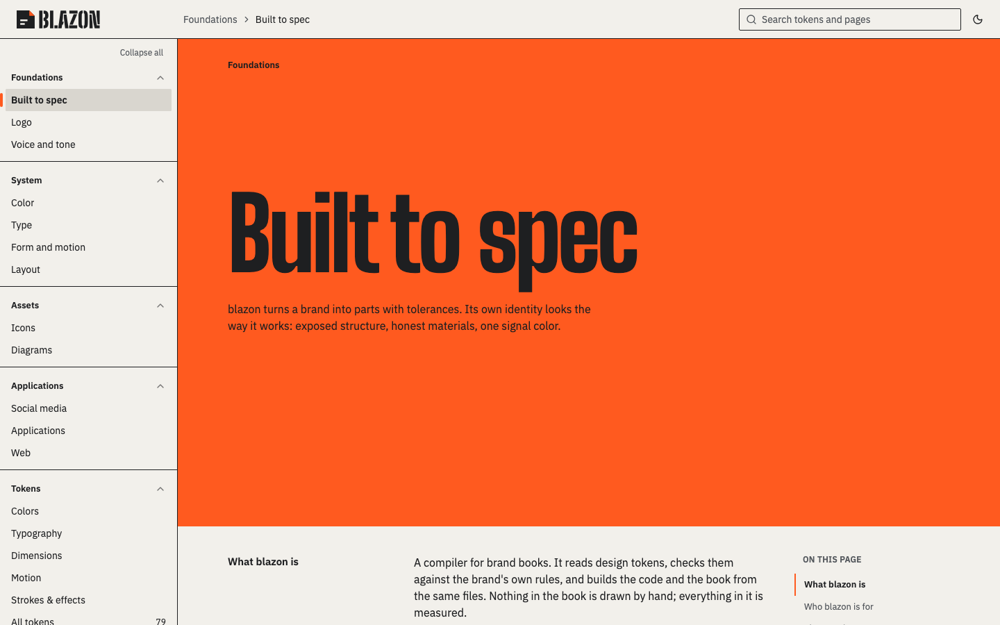
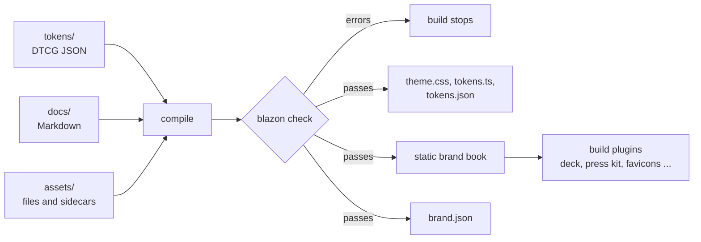

# Blazon

Design tokens, guidelines and brand assets in one repo, compiled into CSS, TypeScript and a brand book that looks like your brand.

[Website](https://blazon-dev.vercel.app) · [Manual](docs/manual/index.md) · [Blazon's own brand book, as source](examples/blazon/) · [Plugins](#plugins) · [Architecture](ARCHITECTURE.md) · [RFCs](docs/rfc)

[](LICENSE) 



Brand guidelines usually live in a PDF or a slide deck, and the values developers need are copied out of it by hand. Blazon keeps them in the repo as [DTCG](https://www.designtokens.org/TR/2025.10/format/) (Design Tokens Community Group) token files and Markdown. One build writes the CSS variables, a typed TypeScript module and a static brand book, and `blazon check` fails the build when a token breaks the brand's own rules. It reads the same DTCG files as Style Dictionary and Tokens Studio, and adds the rules, the checks and the book.

> **Status: pre-release, on npm as `@iksnerd/blazon`.** It is 0.x, so a minor version may break ([versioning](#versioning-and-stability)). The npm package named `blazon` is an unrelated project (a type checker): `npx blazon` in a folder where `@iksnerd/blazon` is not installed runs that one, not this tool. Run it with `npx @iksnerd/blazon <command>`, or install it and run `npx blazon` (the installed program wins) or `./node_modules/.bin/blazon`.

Jump to: [Quick start](#quick-start), [Set up with your agent](#set-up-with-your-agent), [Use blazon from your agent (MCP)](#use-blazon-from-your-agent-mcp), [When not to use blazon](#when-not-to-use-blazon), [How it works](#how-it-works), [Plugins](#plugins), [Commands](#commands), [Configuration](#configuration), [Versioning and stability](#versioning-and-stability), [Security](#security), [Documentation](#documentation), [Contributing](#contributing).

## Quick start

Node 24 or later; macOS and Linux, and WSL on Windows is untried. Install blazon in the folder that holds your brand, then run it:

```bash
npm install @iksnerd/blazon
npx blazon init my-brand
npx blazon dev my-brand   # the book, with live reload, at http://localhost:3000
```

After the install, `npx blazon` runs the installed program. Without an install, write `npx @iksnerd/blazon` in its place, because `npx blazon` alone runs an unrelated package. The rest of this README writes `blazon` for either. To work on blazon itself from a clone, see [CONTRIBUTING](CONTRIBUTING.md#local-setup).

`blazon init` copies blazon's own brand book, [`examples/blazon/`](examples/blazon/), into the folder:

```text
my-brand/
├── tokens/        colors.json, typography.json, spacing.json, form.json, social.json (DTCG), and theme/dark.json
├── docs/          twelve pages, from principles, logo and color to diagrams, social, applications, voice and the web
├── assets/        logos/, construction/, backgrounds/ and icons/, each file with a <name>.json sidecar
├── fonts/         the mono typeface as two font files, with its licence
├── AGENTS.md      notes for a coding agent that edits the brand (CLAUDE.md points to it)
├── blazon.resolver.json   loads the token files and the dark theme
└── blazon.json
```

The book starts as blazon's brand and becomes yours as you replace it. `blazon check` notes every file that is still the starter's text, which is the list of what is left to do, and warns about each logo that is still blazon's own. To start from a company's site instead, run `blazon init acme-brand --from https://acme.com`: blazon reads the page and its stylesheets for colors, fonts and the logo, and flags each value `needs-review` until the brand owner confirms it ([how](docs/manual/01-getting-started.md#starting-from-a-live-site)).

To look at a finished book first, clone the repository and run blazon's own brand book with no build: `npm run dev:blazon` ([CONTRIBUTING](CONTRIBUTING.md#local-setup)).

## Set up with your agent

Paste this into a coding agent (Claude Code, Codex, Cursor) in the folder where the brand should live. Give the agent your colors, fonts and logo, or a site address.

```text
Set up a blazon brand book here. Install it with `npm install @iksnerd/blazon` (never run `npx blazon`
before that: the npm package named `blazon` is an unrelated project), then run it as `npx blazon`.
Run `blazon init brand` (add `--from <site url>` to read a site's colors, fonts and logo).
Read brand/AGENTS.md and follow it. Replace the starter's tokens, docs and assets with my brand:
<my colors, fonts and logo, or the site address>. Ask me for any color, font or license you
do not have; do not guess one. Run `blazon check brand` and fix each finding until it reports no
errors, then run `blazon build brand` and tell me what is still marked needs-review.
Then run `blazon mcp --check --brand brand`; if it reports a failed check or `registered: false`,
run the `fix` it names, and register the server with `blazon mcp --print-config --brand brand`.
```

## Use blazon from your agent (MCP)

A coding agent can ask blazon about the brand as tool calls (`check_brand`, `get_token`, `can_use` and four more, all read-only) instead of reading token files. The server ships inside `@iksnerd/blazon`: `npm install @iksnerd/blazon` gives you its program, `blazon-mcp`, and installs no package for it (it is one file with its libraries bundled in). Print the config for your client and check that it works:

```bash
npx blazon mcp --print-config --client claude-code --brand my-brand
npx blazon mcp --check --brand my-brand                # finds the server? finds blazon? answers a real handshake? registered?
```

`--print-config` prints the command that registers it: `node`, the installed server file, `--brand` and `BLAZON_BIN`. To run the server by hand without installing, `npx -y -p @iksnerd/blazon blazon-mcp --brand my-brand` does it (`blazon-mcp --version` names the MCP SDK and zod it carries).

`blazon mcp --check` writes no file, prints a `fix` command for each check that fails, and exits 1 when the server is not ready. It starts the server on the brand folder, which compiles it with no plugin; what a brand says reaches your agent as tool results, so use a brand you trust. [Blazon for agents](docs/manual/20-blazon-for-agents.md) has the tools and the clients. For an agent that reads skills, [`skills/blazon/SKILL.md`](skills/blazon/SKILL.md) teaches the loop (check, contrast, MCP tools, what never to edit).

## A rule that fails the build

The rules of a brand sit next to its values. In blazon's own tokens, the signal colors are never body text:

```json
"signal": {
  "$extensions": { "dev.blazon": { "usage": { "deny": ["text"] } } },
  "orange": { "$value": "#FF5A1F" }
}
```

A token that sets text in Signal Orange breaks that rule, and `blazon check` says so:

```text
ERROR  tokens/colors.json:155  text.warning: Used as text, but {color.signal.orange} is not allowed as text [usage-violated]
```

The same token is written as `--color-signal-orange: #FF5A1F;` in `theme.css` and as the flat key `"color.signal.orange"` in `tokens.ts`. `tokens.json` nests the same value under `color` > `signal` > `orange`.

`blazon tokens` and `blazon build` run the check first and stop on an error, so the brand's rules hold in CI as well as in review.

## When not to use blazon

- **You need a stable interface.** Blazon is 0.x: a minor version may break a stable surface, and the CHANGELOG lists it under "Breaking". Pin the version you build with ([chapter 15](docs/manual/15-maintaining-a-brand-book.md#pin-the-blazon-you-build-with)).
- **You need many output formats.** Blazon writes CSS, TypeScript and JSON, the Tailwind and shadcn/ui plugins write a Tailwind v4 theme and the shadcn/ui variables, and the platform plugin writes Android, Swift and Kotlin for colors and dimensions only. [Style Dictionary](https://styledictionary.com) has a general system of custom transforms and formats.
- **You want rules enforced in a design tool.** Blazon reads token files in the repo and does not sync with Figma or Tokens Studio. A file exported from them works if it is DTCG 2025.10, but the `usage` roles and `tier` names are blazon's, so the editor will not enforce them.
- **You are on Windows.** It is tested on macOS and Linux with Node 24; WSL is untried.

## How it works



The same compile feeds the dev server, so a change to a token, a page or the config reloads in the browser.

## What it does

- **Reads DTCG 2025.10 tokens.** Every `.json` file in `tokens/` merges into one tree, aliases are full paths (`{color.brand.indigo}`), and composite types (typography, gradient, shadow, border, transition) are supported. [Tokens](docs/manual/02-tokens.md)
- **Holds the brand's rules, not only its values.** `$extensions["dev.blazon"]` carries where a token may be used, its role and tier, print specs (CMYK, PMS, RAL), contrast pairs, forbidden logo backgrounds and proportions.
- **Varies them by context.** A [DTCG resolver document](https://www.designtokens.org/TR/2025.10/resolver/) declares modifiers such as `locale` or `theme`. Each context compiles to its own CSS block holding only what it changes, and the book gets a switcher. [Contexts](docs/manual/04-contexts.md)
- **Checks them.** Bad aliases and types, a token used where its source denies it, contrast below its level, duplicate values, values still marked for review, malformed asset sidecars, page directives that name nothing, and more. [Every finding](docs/manual/03-checks.md)
- **Writes code.** `theme.css`, `typography.css`, a typed `tokens.ts` and a `tokens.json` with aliases resolved. [Using the outputs](docs/manual/08-using-the-outputs.md)
- **Exports the whole brand.** `blazon build` also writes `brand.json`: the tokens with their rules, the pages, the assets and the findings, in one versioned file with a JSON Schema, readable from any language. [`brand.json`](docs/manual/11-brand-json.md)
- **Builds a brand book that wears the brand.** The viewer takes its colors, typefaces and logo from your tokens. Pages place live content from them: swatches, the type scale, the logo on each background with its clear space, icons, patterns and social formats. It has search, a dark mode, and a Review page listing what `blazon check` found. [Pages](docs/manual/05-pages.md), [assets and icons](docs/manual/06-assets-and-icons.md)
- **Compares them with a live site.** `blazon drift <url-or-css-file>` reports which tokens that name a `source.cssVar` have changed since.
- **Answers a coding agent.** The read commands (`blazon get`, `blazon rules`, `blazon can` and the rest) print JSON, and a read-only server, `blazon-mcp`, offers them as tool calls over the Model Context Protocol. It ships inside the blazon package. [Building a website from a brand](docs/manual/19-building-a-website.md), [Blazon for agents](docs/manual/20-blazon-for-agents.md)
- **Extends with plugins.** See below.

## Plugins

A plugin is a program, in any language, that blazon runs for a check or a build step. Blazon ships twelve, so there is nothing to install: name one in `blazon.json` and run `blazon build`. A plugin starts with an empty environment and gets only the variables its manifest lists and you approve in its entry's `env`. The ones that draw in Chrome list `BLAZON_CHROME`, `HOME` and `TMPDIR`:

```json
{
  "plugins": [
    { "name": "blazon.brand-deck", "env": ["BLAZON_CHROME", "BLAZON_DECK_FONTS", "HOME", "TMPDIR"] },
    { "name": "blazon.print-book", "env": ["BLAZON_CHROME", "HOME", "TMPDIR"] }
  ]
}
```

A plugin whose manifest lists a variable that is set, and that the entry does not approve, is not started, and the error names the variable and the key to add.

| Plugin | Writes |
|---|---|
| [`blazon.brand-deck`](docs/manual/14-shipped-plugins.md#blazonbrand-deck) | A PDF deck of 16:9 slides |
| [`blazon.print-book`](docs/manual/14-shipped-plugins.md#blazonprint-book) | The brand book as a PDF and a PowerPoint of pictures |
| [`blazon.copy`](docs/manual/14-shipped-plugins.md#blazoncopy) | Findings for text that breaks the brand's word rules: avoided terms, title-case headings, long sentences |
| [`blazon.favicons`](docs/manual/14-shipped-plugins.md#blazonfavicons) | The favicon and app-icon set, and warnings for a symbol too small or too faint |
| [`blazon.logo-geometry`](docs/manual/14-shipped-plugins.md#blazonlogo-geometry) | Each logo's symmetry, balance and grid, and a construction figure |
| [`blazon.logo-kit`](docs/manual/14-shipped-plugins.md#blazonlogo-kit) | Lockups beside each partner's logo and a clear-space sheet |
| [`blazon.office-template`](docs/manual/14-shipped-plugins.md#blazonoffice-template) | An editable PowerPoint template with the brand's theme |
| [`blazon.platform-tokens`](docs/manual/14-shipped-plugins.md#blazonplatform-tokens) | Android XML, Swift and Kotlin from the color and dimension tokens |
| [`blazon.press-kit`](docs/manual/14-shipped-plugins.md#blazonpress-kit) | A folder and zip for people outside the brand: logos, colors, fonts, a one-page PDF |
| [`blazon.social-cards`](docs/manual/14-shipped-plugins.md#blazonsocial-cards) | Marketing images from the tokens and logo, checked for contrast |
| [`blazon.tailwind`](docs/manual/14-shipped-plugins.md#blazontailwind) | A Tailwind v4 theme from the tokens |
| [`blazon.shadcn`](docs/manual/14-shipped-plugins.md#blazonshadcn) | The shadcn/ui variables, as a mapping and as CSS |

Several need Chrome for their PDF or PNG output; the manual says which. The starter's config lists `blazon.copy` with blazon's own rules, and `blazon.tailwind` and `blazon.shadcn`, which need only Node and write the Tailwind and shadcn/ui files. It leaves out the other plugins of blazon's own book (the deck, the social cards, the favicons, the logo kit, the press kit and the platform and Office files), because most need Chrome and a new book has no use for the kits yet; add one by name when you want it. To write your own, see [Writing a plugin](docs/manual/13-writing-a-plugin.md). A plugin can be pinned, so one that changed on disk does not run.

## Using the tokens

A token's CSS variable is its path, kebab-cased: `interactive.primary` is `--interactive-primary`.

```css
@import './dist/tokens/theme.css';

.button { background: var(--interactive-primary); }
```

```ts
import { getToken, getVar } from './dist/tokens/tokens';

getToken('space.4');           // "16px"
getVar('interactive.primary'); // "var(--interactive-primary)"
```

## Commands

| Command | Does |
|---|---|
| `blazon init [dir]` | Copy the starter into `dir`, asking for a name, color, font and logo in a terminal. `--from <url>` starts from a live site |
| `blazon dev [dir]` | Start the dev server with live reload |
| `blazon check [dir]` | Report findings; exits 1 on errors (`--strict` also fails on warnings, `--json` prints them as JSON) |
| `blazon tokens [dir]` | Check, then write `dist/tokens/` |
| `blazon build [dir]` | Check, then write the tokens and the site to `dist/site/` |
| `blazon preview [dir]` | Serve the built site |
| `blazon drift <url-or-css-file>` | Compare tokens with a live site |
| `blazon list [group]`, `blazon get <path>`, `blazon rules [path]`, `blazon can <fg> <bg>`, `blazon fonts`, `blazon logo`, `blazon brand` | List the tokens, read one, its rules, a text-on-background answer, the fonts, the logo or the whole compiled brand (`blazon brand`, always JSON); `--json` prints JSON |
| `blazon explain [code]` | Say what a finding code means, its severity, the fix and where to read more; with no code, list every code |
| `blazon doctor` | Check this machine and folder: Node version, brand folder, plugin folder safety, Chrome (if a plugin needs it) and `blazon.lock`. Writes nothing |
| `blazon pin [dir]` | Write `blazon.lock`, so only the pinned blazon runs `check`, `tokens` and `build` |

`blazon approvals`, `blazon mcp` (`--print-config`, `--check`) and `blazon plugin check`, `pin` and `profile` are in the [manual](docs/manual/01-getting-started.md#commands) with every flag.

## Configuration

`blazon.json` is optional only in name: a brand must name a `logo`, or `blazon check` fails with `logo-missing`. The common options:

```json
{
  "title": "Acme Brand Book",
  "theme": { "accent": "interactive.primary", "text": "text.primary", "fontDisplay": "font.family.display" },
  "logo": { "onLight": "./assets/logos/logo-black.svg", "onDark": "./assets/logos/logo-white.svg" },
  "iconSets": [
    {
      "name": "lucide",
      "package": "lucide-static",
      "categories": { "Navigation": [ "arrow-left", "house" ] }
    }
  ],
  "fonts": [ "https://fonts.googleapis.com/css2?family=Inter:wght@400;600&display=swap" ]
}
```

Every option and the theme roles are in [Theme and configuration](docs/manual/07-theme-and-config.md). The file is plain JSON, read as data and never run: no comments, no code. A config written as `blazon.config.ts` (or `.js`, `.mjs`, or `brandbook.config.*`) is refused with an error that names the file; move its values into `blazon.json`. The functions the CLI uses are exported for scripts (`compileBlazonData`, `checkTokens`, `emitTokenOutputs`, `buildSite`, `startDevServer` and more; see `src/index.ts`).

## Examples

- [`examples/blazon/`](examples/blazon/): blazon's own brand book, made from scratch: 79 tokens, a light and a dark theme, twelve pages, and `blazon check examples/blazon` reports no findings (a copy made with `blazon init` also notes each starter file and warns about the two logos until you replace them). It is also the starter `blazon init` copies.
- [`examples/conformance/`](examples/conformance/): a small fictional brand for the parts of the data model the starter does not reach: review approvals, font metadata, a logo initiative and an experimental asset category. It is the conformance fixture for the tests.

Brand books made from other companies' guidelines are not shipped in this repository, because their art and text belong to those companies. A maintainer can keep them locally; see [CONTRIBUTING](CONTRIBUTING.md#reference-material-maintainers-only).

## Versioning and stability

While blazon is 0.x, a breaking change to a stable surface raises the minor version and is listed under "Breaking" in the [CHANGELOG](CHANGELOG.md). [Chapter 18](docs/manual/18-stability.md) says which surfaces are stable, what each kind of release may contain, and what 1.0 will require (a plan, not yet met).

## Security

To report a vulnerability, read [SECURITY.md](SECURITY.md). Do not open a public issue.

## Documentation

- [Manual](docs/manual/index.md): how to use blazon, chapter by chapter, from [getting started](docs/manual/01-getting-started.md) to [maintaining a brand book](docs/manual/15-maintaining-a-brand-book.md), with [troubleshooting](docs/manual/10-troubleshooting.md) and [deriving your own brand](docs/manual/09-derive-your-own.md). The [glossary](docs/manual/16-glossary.md) defines every word, [the data model](docs/manual/17-data-model.md) lists every field, and [stability](docs/manual/18-stability.md) says what a brand can rely on when it moves its pin.
- [Architecture](ARCHITECTURE.md): the layers of `src/`, a code map and the invariants, for someone about to change blazon.
- RFCs, each with a Status table of what is built:
  [0001 data model](docs/rfc/0001-data-model.md),
  [0002 extension model](docs/rfc/0002-extension-model.md),
  [0003 adopting blazon](docs/rfc/0003-adopting-blazon.md),
  [0004 format rules](docs/rfc/0004-format-rules.md),
  [0005 plugin protocol](docs/rfc/0005-plugin-protocol.md),
  [0006 copy rules](docs/rfc/0006-copy-rules.md),
  [0007 recommended contents](docs/rfc/0007-recommended-contents.md),
  [0008 print units and brand rules](docs/rfc/0008-print-units-and-brand-rules.md).

## Contributing

```bash
npm test                 # vitest, including golden-file conformance for examples/conformance
npm run check            # typecheck, ESLint, Ruff and Prettier
npm run dev:blazon        # blazon's own brand book from source, with live reload
```

[ARCHITECTURE](ARCHITECTURE.md) maps the code. [CONTRIBUTING](CONTRIBUTING.md) lists the test layout and what the commit and push hooks run. After a deliberate output change, regenerate the golden files with `UPDATE_GOLDEN=1 npx vitest run test/core/tokens/conformance.test.ts` and review the diff. `test/docs/manual.test.ts` fails when a command, flag, config key, directive, `dev.blazon` field or finding code is not documented in `docs/manual/`, so document what you add.

## License

MIT, see [LICENSE](LICENSE). The plugin conformance corpus in `test/spec/` is a copy of a plugin specification's, licensed Apache-2.0 (`test/spec/LICENSE`, `test/spec/NOTICE`); `test/spec/SOURCE.json` names the commit it came from. Another company's brand guidelines are not part of this repository. Blazon's own brand book, `examples/blazon/`, holds hand-drawn SVG and no generated images.
